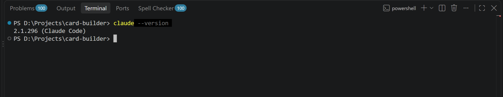
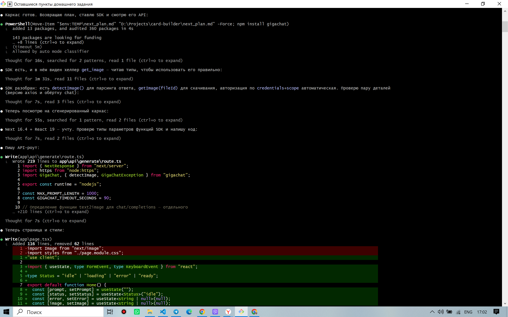
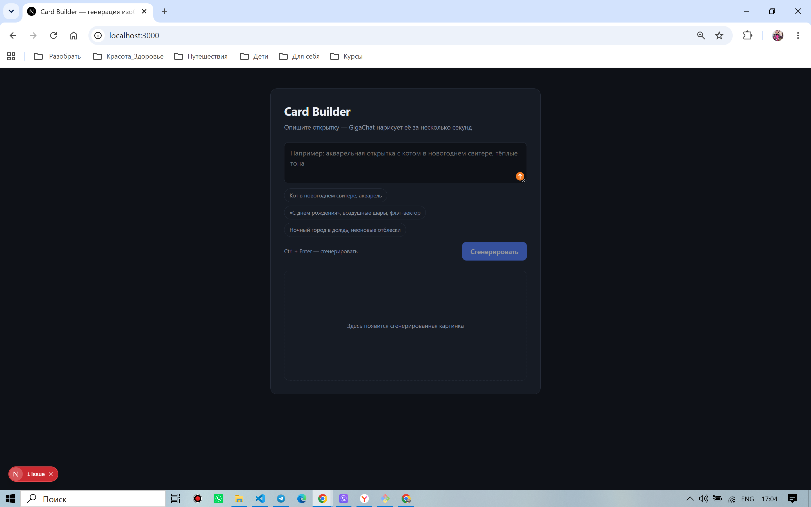
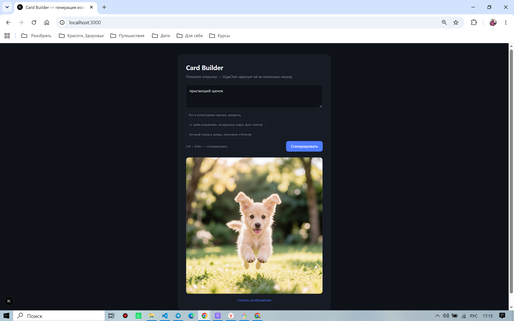
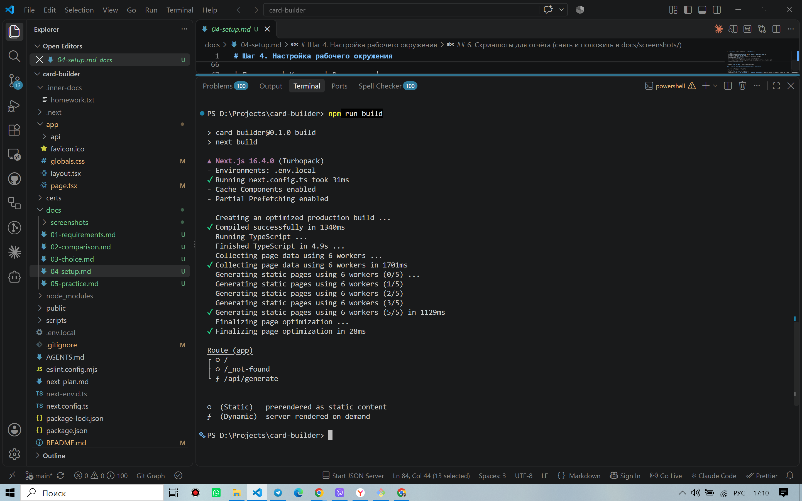

# Отчёт: сравнительный анализ и настройка AI-инструментов

**Задача ДЗ:** сравнительный анализ Cloud-агентов и IDE/CLI-агентов для конкретной задачи
разработки, выбор оптимального инструмента, настройка окружения и практическое применение.

**Проект-основа:** card-builder — веб-приложение генерации изображений по текстовому
промпту через GigaChat API ([репозиторий](./), детали в [docs/](docs/)).

**Выбранный инструмент:** Claude Code (CLI-агент) + модель GLM от Z.AI.

**Дата:** 2026-10-11. **Автор:** Raisa.

---

## 1. Задача и требования

Одностраничное веб-приложение: пользователь вводит промпт → `POST /api/generate` →
серверный API-роут получает OAuth-токен GigaChat, вызывает генерацию через
`chat/completions` с функцией `text2image`, скачивает файл по uuid → возвращает
изображение как base64 data-URL.

**Стек:** Next.js 16 (App Router), TypeScript, React 19, SDK `gigachat`.
**Секреты:** Authorization Key СберБанка — только на сервере, в локальном `.env` вне git.

Ключевые требования к AI-инструменту (полная версия — [docs/01-requirements.md](docs/01-requirements.md)):

| Критерий | Требование |
|---|---|
| Сложность | Средняя: full-stack в одном репо, нетривиальная интеграция с внешним API — нужен агентный цикл «правка → запуск → проверка» |
| Доступ к локальным файлам | Обязателен: существующий локальный проект, git, ключ в локальном `.env` |
| Безопасность данных | Ключ API банка не должен попадать в облачные песочницы вендоров |
| Бюджет | Учебный проект: фиксированная стоимость порядка ≤ 10 $/мес |
| Workflow | Работа в терминале + git, перенос контекста между сессиями |

## 2. Сравнительный анализ инструментов

Методика: шкала 1–5 по критериям задания, оценка применительно к данной задаче
(методика и полное обоснование каждого балла — [docs/02-comparison.md](docs/02-comparison.md)).

| Критерий | Bolt.new | Lovable | Replit Agent | Cursor | Claude Code | Aider |
|---|:---:|:---:|:---:|:---:|:---:|:---:|
| Доступ к контексту проекта | 2 | 2 | 3 | 5 | **5** | 4 |
| Скорость генерации кода | 5 | 5 | 4 | 4 | 4 | 4 |
| Качество кода | 3 | 3 | 3 | 4 | **4** | 4 |
| Стоимость использования | 3 | 3 | 2 | 3 | **5** ¹ | 4 |
| Безопасность данных | 2 | 2 | 2 | 3 | **4** | 4 |
| Интеграция в рабочий процесс | 3 | 3 | 3 | 4 | **5** | 4 |
| **Итого (справочно)** | 18 | 18 | 17 | 23 | **27** | 24 |

¹ Claude Code с родной подпиской Anthropic (≈20–100+ $/мес) получил бы 3. Оценка 5 отражает
фактическую схему: Claude Code + модель GLM от Z.AI (GLM Coding Plan, фиксированная цена
порядка нескольких долларов в месяц).

Ключевые обоснования (кратко):

- **Доступ к контексту** — решающая ось: Cloud-агенты работают только в своей песочнице
  (баллы 2–3), локальные агенты — с реальной папкой проекта, терминалом и git.
- **Безопасность** — у Cloud-агентов код и переменные окружения живут в облаке вендора:
  прямое противоречие требованию «ключ банка не покидает машину». Локальные агенты
  отправляют наружу только контекст запросов к модели.
- **Скорость** — единственный критерий, где Cloud-агенты выигрывают: мгновенный
  прототип «с нуля» с live-preview.
- **Стоимость** — предсказуемость важнее абсолютной цены: Replit (подписка + usage)
  худший; Claude Code с GLM-планом — фикс, заметно ниже конкурентов.

## 3. Выбор инструмента и обоснование

**Выбран Claude Code + модель GLM (Z.AI)** — полная версия с альтернативами:
[docs/03-choice.md](docs/03-choice.md).

| Фактор | Почему решило выбор |
|---|---|
| Локальный проект и секреты | Агент работает в существующей папке; код и `.env` не покидают машину |
| Сложность интеграции GigaChat | Агентный цикл с самопроверкой (lint/build/dev-сервер) вместо разовой генерации |
| Бюджет | GLM Coding Plan — фиксированная минимальная цена |
| Workflow | Терминал + git native; план проекта переносится файлом между сессиями (`next_plan.md`) |

**Альтернативы:**

- **Bolt.new / Lovable / Replit Agent** — модель работы несовместима с двумя жёсткими
  требованиями (локальный проект, секрет в `.env`). Сильны в прототипах «с нуля» без
  чувствительных данных — не наш случай.
- **Cursor** — сильная альтернатива (23 балла); проиграл по стоимости (~20 $/мес против
  GLM-плана) и по workflow (требует его редактор вместо терминального процесса).
- **Aider** — ближайший конкурент по философии (24 балла); проиграл по автономности
  агента (самопроверка, выполнение команд) и расширяемости (MCP, память проекта).

Выбор агента и модели — независимые решения: Claude Code допускает разные модели через
совместимый API; при необходимости перехода на родные модели Claude меняется только
endpoint, не процесс работы.

## 4. Настройка рабочего окружения

Полная версия — [docs/04-setup.md](docs/04-setup.md).

| Компонент | Версия |
|---|---|
| Node.js | v20.20.2 |
| npm | 10.8.2 |
| Git | 2.51.2.windows.1 |
| Claude Code (CLI) | 2.1.296 |

- Claude Code установлен как CLI-инструмент, модель GLM подключена через
  Anthropic-совместимый endpoint Z.AI (ключи — только в локальной конфигурации).
- **MCP:** обоснованное решение «не требуется» — задаче достаточно нативных возможностей
  агента (файлы, терминал, git); подключение при необходимости — одна команда
  (`claude mcp add …`). Это соответствует требованию безопасности (минимум интеграций).
- Тестовый проект — сам card-builder: `npm install`, `.env.local` с ключом GigaChat,
  `npm run dev`. Проверки: `npm run lint` — чисто; `npm run build` — `✓ Compiled successfully`,
  TypeScript без ошибок; production-сервер отвечает HTTP 200.

> 📷 *Плейсхолдер: положить файл `docs/screenshots/01-claude-version.png` — вывод `claude --version`.*

> 📷 *Плейсхолдер: положить файл `docs/screenshots/02-agent-session.png` — сессия агента в процессе работы (агентный цикл: чтение файлов → правки).*

## 5. Практическое применение

Полная версия с хронологией — [docs/05-practice.md](docs/05-practice.md).

### 5.1. Основной проект (реконструкция процесса)

Workflow «сначала план — потом код»: в первой сессии с агентом обсуждались и
утверждались архитектурные решения, итогом стал **файл-план** (`next_plan.md`); вторая
сессия стартовала коротким промптом «Реализуй по плану из next_plan.md».

| Промпт (по смыслу) | Результат |
|---|---|
| Обсуждение задачи и стека | Утверждён план: Next.js (App Router, TS), API Route, секреты на сервере |
| «Реализуй по плану из next_plan.md» | Каркас приложения: страница, API-роут, интеграция SDK |
| Серия уточнений по ошибкам и краевым случаям | Обработка ошибок, TLS, выбор модели |

Сложности, решённые в итерациях с агентом: генерация GigaChat идёт через функции
`chat/completions` (нет отдельного endpoint'а) и возвращает uuid файла вместо URL;
latin1-кодировка скачанного файла; корневой сертификат Минцифры в TLS; свежая версия
Next.js с изменёнными конвенциями (агенту предписано сверяться с документацией из
`node_modules` через `AGENTS.md`).

### 5.2. Свежая задача: подсказки-примеры промптов

Задача: кликабельные подсказки под textarea — клик заполняет поле и запускает генерацию.

- **Итераций правок: 1.** Агент прочитал существующий код и стили, сверился с
  документацией Next.js из `node_modules`, добавил чипы (`app/page.tsx`) и стили
  (`app/globals.css`), самостоятельно обошёл ловушку асинхронности `setState`
  (текст передаётся аргументом `generate(text)`, а не читается из стейта после `setPrompt`).
- **Изменённых файлов: 2; ручных исправлений после агента: 0.**
- Верификация: lint ✓, build ✓, smoke-тест production-сервера (HTTP 200, чипы в разметке) ✓.
- Любопытный факт планирования: исходная задача-кандидат («кнопка Скачать») уже была
  реализована — состояние кода проверялось до постановки задачи.

> 📷 *Плейсхолдер: положить файл `docs/screenshots/03-app-start.png` — стартовый экран с чипами-подсказками.*

> 📷 *Плейсхолдер: положить файл `docs/screenshots/04-app-result.png` — сгенерированное изображение + кнопка «Скачать изображение».*

> 📷 *Плейсхолдер: положить файл `docs/screenshots/05-build.png` — вывод `npm run build`.*

## 6. Выводы и рекомендации

1. **Для задач класса «существующий локальный проект + секреты» локальные CLI-агенты
   выигрывают принципиально**, а не по баллам: Cloud-агенты несовместимы с самими
   требованиями. Их ниша — быстрые прототипы «с нуля» без чувствительных данных.
2. **Workflow «план в файле + короткий промпт» дал квантованность итераций:**
   основная задача и контрольная обе закрыты с первой итерации правок. Фиксация решений
   до кода (`next_plan.md`) — главный переносимый приём из практики.
3. **Агент ≠ модель.** Claude Code как оболочка допускает замену модели (GLM ↔ Claude)
   без смены процесса — выбор можно пересматривать по мере задач и цен.
4. **Ценность агента проявляется вне «просто генерации кода»:** предметные сложности
   проекта (протокол GigaChat, TLS, кодировки, свежий фреймворк) решались чтением
   документации и самопроверкой, а не разовой генерацией правдоподобного кода.
5. **Рекомендация по критерию безопасности:** локальный агент + секреты в `.env` вне git +
   минимум MCP-интеграций — воспроизводимый минимум для работы с чувствительными ключами.

## 7. Артефакты

| Артефакт | Где |
|---|---|
| Сравнительная таблица + обоснования | Этот документ (§2), [docs/02-comparison.md](docs/02-comparison.md) |
| Требования | [docs/01-requirements.md](docs/01-requirements.md) |
| Выбор и альтернативы | [docs/03-choice.md](docs/03-choice.md) |
| Настройка окружения | [docs/04-setup.md](docs/04-setup.md) |
| Лог практического применения | [docs/05-practice.md](docs/05-practice.md) |
| Код проекта | `app/` (страница + API-роут), план — `next_plan.md` |
| Скриншоты | `docs/screenshots/` (5 файлов — см. плейсхолдеры выше) |
